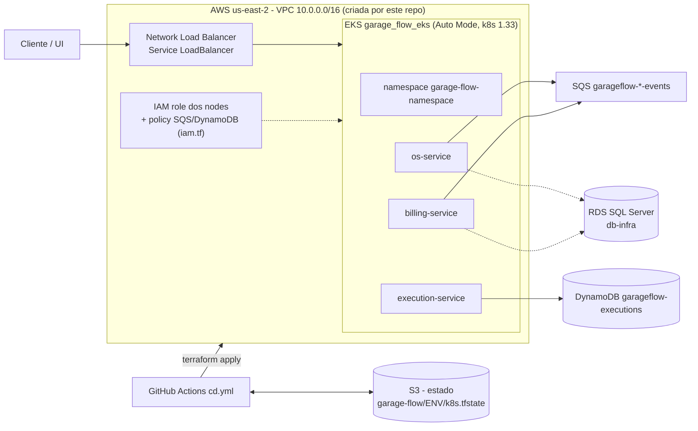

# fiap-garageflow-k8s-infra

Infraestrutura como código (Terraform) do **cluster Amazon EKS** do GarageFlow: VPC e subnets do cluster, EKS (modo Auto), Security Groups e a política IAM que dá aos pods acesso a SQS e DynamoDB. O repositório também guarda os manifests Kubernetes (`k8s/`) do **monólito legado** (`fiap-garageflow-api`).

Projeto do Tech Challenge Fase 4 (FIAP Pós Tech): a oficina mecânica, antes um monólito, foi refatorada em microsserviços (`os`, `billing`, `execution`) executados no EKS, na AWS (`us-east-2`), com deploy via GitHub Actions + Terraform.

## Sumário

- [Visão geral da solução](#visão-geral-da-solução)
- [O que este repositório provisiona](#o-que-este-repositório-provisiona)
- [Variáveis do Terraform](#variáveis-do-terraform)
- [Outputs](#outputs)
- [Estado remoto (S3)](#estado-remoto-s3)
- [Manifests Kubernetes (`k8s/`)](#manifests-kubernetes-k8s)
- [Pipelines](#pipelines)
- [Como executar](#como-executar)
- [Dependências e ordem de deploy](#dependências-e-ordem-de-deploy)
- [Segurança](#segurança)
- [Custos e limpeza](#custos-e-limpeza)
- [Troubleshooting](#troubleshooting)
- [Status e pendências](#status-e-pendências)

## Visão geral da solução



Linhas tracejadas: dependências que **não** são garantidas por este repositório (veja [Status e pendências](#status-e-pendências) sobre a VPC do RDS).

### Repositórios da solução

Todos em `https://github.com/FiapPosEAA/<repo>`.

| Repositório | Papel |
|---|---|
| `fiap-garageflow-api` | Monólito legado (.NET) e documentação de arquitetura/ADR |
| `fiap-garageflow-db-infra` | RDS SQL Server (instância única, bancos `garageflow-os` e `garageflow-billing`) e rede |
| `fiap-garageflow-k8s-infra` | **Este repo** - EKS, rede do cluster e IAM dos nodes |
| `fiap-garageflow-lambda-auth` | Lambda de autenticação por CPF + JWT e API Gateway |
| `garageflow-os-service` | Microsserviço de ordens de serviço; provisiona as filas SQS (workflow `Provision SQS`) |
| `garageflow-billing-service` | Microsserviço de faturamento |
| `garageflow-execution-service` | Microsserviço de execução; provisiona a tabela DynamoDB (workflow `Provision DynamoDB`) |
| `garageflow-ui` | Front-end |

## O que este repositório provisiona

Código em [terraform/](terraform/). Provider `hashicorp/aws` fixado em `6.59.0` ([providers.tf](terraform/providers.tf)); módulo `terraform-aws-modules/eks/aws` com `version = "~> 21.0"`.

| Recurso Terraform | Arquivo | Detalhes |
|---|---|---|
| `aws_vpc.garage_flow_vpc` | `main.tf` | `10.0.0.0/16`, DNS support e hostnames |
| `aws_internet_gateway.garage_flow_igw` | `main.tf` | IGW |
| `aws_subnet.garage_flow_subnet_az_a` / `_az_b` | `main.tf` | Públicas `10.0.1.0/24` e `10.0.2.0/24` (`<região>a`/`<região>b`); tags `kubernetes.io/cluster/garage_flow_eks` e `kubernetes.io/role/elb` |
| `aws_route_table.garage_flow_rt` + associações `garage_flow_rta_az_a/_az_b` | `main.tf` | `0.0.0.0/0` -> IGW nas subnets públicas |
| `aws_eip.garage_flow_nat_eip` | `main.tf` | EIP do NAT |
| `aws_nat_gateway.garage_flow_nat` | `main.tf` | NAT na subnet pública `az_a` |
| `aws_subnet.garage_flow_private_subnet_az_a` / `_az_b` | `main.tf` | Privadas `10.0.3.0/24` e `10.0.4.0/24`; tag `kubernetes.io/role/internal-elb` |
| `aws_route_table.garage_flow_private_rt` + associações `garage_flow_private_rta_az_a/_az_b` | `main.tf` | `0.0.0.0/0` -> NAT nas subnets privadas |
| `module.eks` | `eks.tf` | Cluster `garage_flow_eks`, Kubernetes `1.33`, endpoint público, `enable_cluster_creator_admin_permissions = true`, **EKS Auto Mode** (`compute_config` com node pool `general-purpose`), nas 4 subnets; tags `Environment=Prod`, `Tenant=fiap`, `Terraform=true` |
| `aws_security_group.elb_sg` | `sg.tf` | Nome `garage-flow-elb-sg`; ingress TCP 80 de `0.0.0.0/0`; egress total |
| `aws_vpc_security_group_ingress_rule.nodes_nodeport_from_elb` | `sg.tf` | No SG dos nodes (`module.eks.node_security_group_id`): TCP `30000-32767` de `0.0.0.0/0` (NodePort) |
| `aws_iam_role_policy.nodes_messaging_and_data` | `iam.tf` | Policy `garageflow-sqs-dynamodb-access` na role dos nodes (detalhe abaixo) |
| `data.aws_caller_identity.current` | `s3.tf` | Conta usada para montar os ARNs |
| `aws_s3_bucket.terraform_state` | `s3.tf` | Bucket `garage-flow-<account_id>-terraform-state` (sem versionamento/criptografia configurados no código) |

Recursos internos do módulo EKS (lidos do código local do módulo `21.x`): cluster EKS, roles IAM do cluster e do Auto Mode (inclui a role dos nodes usada em `iam.tf`), Security Group do cluster, log group do CloudWatch, access entries, provider OIDC (IRSA habilitado por padrão) e chave KMS (`create_kms_key = true` por padrão), entre outros.

### Política IAM dos nodes ([terraform/iam.tf](terraform/iam.tf))

Os pods usam a cadeia padrão de credenciais do AWS SDK, que resolve para a role dos nodes. A policy permite apenas:

| Serviço | Ações | Recurso |
|---|---|---|
| SQS | `SendMessage`, `ReceiveMessage`, `DeleteMessage`, `GetQueueAttributes`, `GetQueueUrl` | `arn:aws:sqs:<região>:<conta>:garageflow-*-events` |
| DynamoDB | `GetItem`, `PutItem`, `UpdateItem`, `Query`, `DescribeTable` | tabela `garageflow-executions` e `.../index/*` |

As filas e a tabela **não** são criadas aqui: vêm dos workflows `Provision SQS` (`garageflow-os-service`) e `Provision DynamoDB` (`garageflow-execution-service`). A policy não exige que existam no momento do `apply`.

## Variáveis do Terraform

Definidas em [terraform/vars.tf](terraform/vars.tf). **Nenhuma tem valor padrão.**

| Variável | Tipo | Obrigatória | Uso real |
|---|---|---|---|
| `aws_region` | string | Sim | Provider, AZs das subnets e ARNs de `iam.tf` |
| `cluster_name` | string | Sim | **Não usada** (o cluster é fixo em `garage_flow_eks` em `eks.tf`) |
| `sql_db_name` | string | Sim | **Não usada** por nenhum recurso |
| `sql_db_user` | string | Sim | **Não usada** por nenhum recurso |
| `sql_db_password` | string, `sensitive` | Sim | **Não usada** por nenhum recurso |

No pipeline, são preenchidas por `TF_VAR_*` (veja [Pipelines](#pipelines)). Localmente, o Terraform pedirá todas interativamente, a menos que sejam exportadas.

## Outputs

Definidos em [terraform/outputs.tf](terraform/outputs.tf).

| Output | Valor |
|---|---|
| `eks_cluster_name` | Nome do cluster (`garage_flow_eks`) |
| `eks_cluster_endpoint` | Endpoint da API do cluster |
| `eks_cluster_arn` | ARN do cluster |
| `elb_security_group_id` | ID do SG `garage-flow-elb-sg` |

Não há outputs de VPC/subnets (necessários, por exemplo, para integrar com `db-infra`).

## Estado remoto (S3)

Backend `backend "s3" {}` configurado no `terraform init`:

| Parâmetro | Valor |
|---|---|
| `bucket` | Secret de organização `TF_STATE_BUCKET` |
| `key` | `garage-flow/<producao\|homologacao>/k8s.tfstate` |
| `region` | `AWS_REGION` (padrão `us-east-2`) |
| `encrypt` | `true` |
| `use_lockfile` | `true` (requer Terraform >= 1.10; pipelines usam **1.10.5**) |

O bucket de estado precisa existir antes do primeiro `init`. Atenção: o `aws_s3_bucket.terraform_state` declarado em `s3.tf` é **outro** bucket (`garage-flow-<account_id>-terraform-state`) e não é o apontado por `TF_STATE_BUCKET` (veja pendências).

## Manifests Kubernetes (`k8s/`)

Os arquivos em [k8s/](k8s/) descrevem a **API monolítica legada** (`fiap-garageflow-api`). Nenhum workflow deste repositório os aplica: o `cd.yml` só roda Terraform.

| Arquivo | Recurso | Conteúdo |
|---|---|---|
| [namespace.yaml](k8s/namespace.yaml) | `Namespace` | `garage-flow-namespace` (compartilhado também pelos microsserviços) |
| [configmap.yml](k8s/configmap.yml) | `ConfigMap garage-flow-configmap` | `ASPNETCORE_URLS=http://+:8080`, `Jwt__Issuer=GarageFlowService`, `Jwt__Audience=GarageFlowServiceClients`, `DB__Encrypt=true` |
| [deployment.yml](k8s/deployment.yml) | `Deployment garage-flow-deployment` | Imagem `raphaelbrodrigues/garage_flow_v1` (sem tag, ou seja `latest`), porta 8080, `envFrom` do ConfigMap e do Secret `garage-flow-secrets`, probes em `/health` (readiness 10s/10s, liveness 30s/20s), requests `100m`/`256Mi`, limits `500m`/`512Mi` |
| [service.yml](k8s/service.yml) | `Service garage-flow-service` | `LoadBalancer` (anotações `aws-load-balancer-type: nlb` e `scheme: internet-facing`), porta 80 -> 8080 |
| [hpa.yml](k8s/hpa.yml) | `HorizontalPodAutoscaler garage-flow-hpa` | 1 a 2 réplicas, CPU média 75% |

O Secret `garage-flow-secrets` **não** está versionado. O workflow `cd.yml` do repo `fiap-garageflow-api` o cria (chaves `ConnectionStrings__DefaultConnection` e `Jwt__Key`, a partir dos secrets `DEFAULT_CONNECTION` e `JWT_SECRET`) e só executa `kubectl set image` no Deployment existente; ele **não** aplica estes manifests nem cria o namespace. Logo, é preciso aplicá-los uma vez, manualmente (veja [Como executar](#como-executar)).

Os microsserviços (`os`, `billing`, `execution`) têm seus próprios manifests em `k8s/` nos respectivos repositórios e os aplicam nos seus workflows de CD, no mesmo namespace `garage-flow-namespace`.

## Pipelines

Workflows em [.github/workflows/](.github/workflows/).

### `ci.yml` - CI

- **Gatilhos:** `push` em `main`; `pull_request` para `main`.
- **Passos (job `validate`, diretório `terraform`):** `terraform fmt -check` -> `terraform init -backend=false` -> `terraform validate` (Terraform 1.10.5).
- **Secrets/Variables:** nenhum.

### `cd.yml` - CD Kubernetes Infrastructure

- **Gatilhos:** `push` em `main` e `homologacao`; `workflow_dispatch`.
- **Ambiente GitHub:** `producao` (branch `main`) ou `homologacao` (demais).
- **Concorrência:** grupo `terraform-k8s-<branch>`.
- **Passos:** checkout -> `setup-terraform` 1.10.5 -> `configure-aws-credentials` -> `terraform init` (chave `garage-flow/<env>/k8s.tfstate`) -> `terraform apply -auto-approve`. Sem `plan` separado; o `apply` **não** aplica manifests `k8s/`.
- **Secrets (nomes):** `AWS_ACCESS_KEY_ID`, `AWS_SECRET_ACCESS_KEY`, `TF_STATE_BUCKET`, `DB_NAME`, `DB_USER`, `DB_PASSWORD` (os três últimos viram `TF_VAR_sql_db_name`, `TF_VAR_sql_db_user`, `TF_VAR_sql_db_password`, variáveis sem uso real).
- **Variables:** `AWS_REGION` (padrão `us-east-2`) e `EKS_CLUSTER_NAME` (padrão `garageflow`, que vira `TF_VAR_cluster_name`, sem uso real).

## Como executar

### Via pipeline

1. Configure os secrets e variables acima nos ambientes `homologacao`/`producao` (ou na organização `FiapPosEAA`).
2. Faça push em `homologacao`/`main` ou rode `CD Kubernetes Infrastructure` manualmente.
3. Defina nos repositórios dos serviços a variable `EKS_CLUSTER_NAME` com o nome **real** do cluster (`garage_flow_eks`, ver output `eks_cluster_name`), pois é ela que os workflows usam em `aws eks update-kubeconfig`.

### Localmente

Pré-requisitos: Terraform >= 1.10, AWS CLI e `kubectl`.

```bash
aws sts get-caller-identity

cd terraform
export TF_VAR_aws_region="us-east-2"
# Obrigatórias pelo vars.tf, mas sem uso real nos recursos:
export TF_VAR_cluster_name="garage_flow_eks"
export TF_VAR_sql_db_name="<nome>"
export TF_VAR_sql_db_user="<usuario>"
export TF_VAR_sql_db_password="<senha>"   # nunca commitar

terraform init \
  -backend-config="bucket=<TF_STATE_BUCKET>" \
  -backend-config="key=garage-flow/homologacao/k8s.tfstate" \
  -backend-config="region=us-east-2" \
  -backend-config="encrypt=true" \
  -backend-config="use_lockfile=true"

terraform fmt -check
terraform validate
terraform plan
terraform apply

terraform output eks_cluster_name
```

Acesso ao cluster e aplicação manual dos manifests do monólito (opcional, só se for usar a API legada):

```bash
aws eks update-kubeconfig --region us-east-2 --name garage_flow_eks
kubectl get nodes

kubectl apply -f k8s/namespace.yaml
kubectl apply -f k8s/configmap.yml
# Crie antes o Secret garage-flow-secrets (ConnectionStrings__DefaultConnection e Jwt__Key) com valores seus
kubectl apply -f k8s/deployment.yml
kubectl apply -f k8s/service.yml
kubectl apply -f k8s/hpa.yml

kubectl -n garage-flow-namespace get pods,svc,hpa
```

## Dependências e ordem de deploy

Ordem recomendada: db-infra -> **k8s-infra** -> lambda-auth -> SQS -> DynamoDB -> serviços.

- **Depende de:** `fiap-garageflow-db-infra` apenas conceitualmente (o RDS precisa ser alcançável pelos pods). **No código não há nenhuma ligação**: este repo cria sua própria VPC (veja pendências).
- **Entrega para:** os repositórios dos serviços (`os`, `billing`, `execution`) e `fiap-garageflow-api`, que usam o cluster (`EKS_CLUSTER_NAME`) e o namespace `garage-flow-namespace`.
- **SQS e DynamoDB** (provisionados depois, em `garageflow-os-service` e `garageflow-execution-service`) precisam respeitar os nomes liberados em `iam.tf`: filas `garageflow-*-events` e tabela `garageflow-executions`; fora desses nomes, os pods recebem `AccessDenied`.

## Segurança

- **Menor privilégio dos pods:** `iam.tf` limita SQS às filas `garageflow-*-events` e DynamoDB à tabela `garageflow-executions`, com ações mínimas. Porém a role é **dos nodes**: todos os pods do cluster herdam essas permissões. A alternativa mais restrita seria IRSA/Pod Identity por serviço (o OIDC provider é criado pelo módulo, mas não há roles por ServiceAccount aqui).
- **Rede:** a regra `nodes_nodeport_from_elb` abre `30000-32767` para `0.0.0.0/0` no SG dos nodes; restrinja ao SG/CIDR do load balancer. O endpoint do cluster é público (`endpoint_public_access = true`), com administração concedida ao criador (`enable_cluster_creator_admin_permissions`).
- **Segredos:** nunca versione valores. O pipeline usa os secrets `DB_PASSWORD`, `AWS_ACCESS_KEY_ID`, `AWS_SECRET_ACCESS_KEY` (somente nomes aqui). O ConfigMap guarda apenas dados não sensíveis; senhas e a chave JWT vão em Secret do Kubernetes criado pelo CD de cada serviço. A senha `sql_db_password` (sensível) iria para o state se fosse usada, mas hoje nenhum recurso a usa.
- **Credenciais AWS dos pipelines:** chaves de acesso de longa duração; o usuário IAM precisa de permissões para VPC/EC2, EKS, IAM, KMS, CloudWatch Logs, ELB e S3. Não há OIDC configurado.
- **SCP:** a conta pode ter SCP que bloqueia login no console IAM; use CLI/chaves de acesso e planeje permissões IAM com antecedência, pois este repo cria roles/policies (`iam:*` necessário no usuário do pipeline).
- **Estado:** o state contém dados sensíveis do cluster; mantenha o bucket privado, versionado e criptografado.

## Custos e limpeza

Geram custo contínuo: control plane do EKS, nodes do Auto Mode (cobrados pelas instâncias criadas pelo pool `general-purpose`), NAT Gateway + EIP, Network Load Balancer criado pelo Service, e KMS/CloudWatch Logs do módulo.

Não existe workflow de destroy neste repositório. Para remover:

```bash
# 1. Remova antes os Services LoadBalancer (e demais workloads) para que o NLB e as ENIs sejam apagados
kubectl delete svc --all -n garage-flow-namespace
kubectl delete namespace garage-flow-namespace

# 2. Destrua a infraestrutura
cd terraform
terraform init -backend-config="bucket=<TF_STATE_BUCKET>" -backend-config="key=garage-flow/<env>/k8s.tfstate" -backend-config="region=us-east-2" -backend-config="encrypt=true" -backend-config="use_lockfile=true"
terraform plan -destroy
terraform destroy
```

Destrua primeiro serviços, DynamoDB, SQS e lambda-auth; este repo vem antes de `db-infra` na ordem inversa. O workflow `Terraform Reset` do repo `fiap-garageflow-db-infra` apaga **toda** a conta/região (incluindo VPCs e buckets S3) e não remove o EKS; use-o apenas como último recurso, em conta descartável.

## Troubleshooting

1. **`terraform plan` pergunta valores de `sql_db_*` e `cluster_name`.** São variáveis obrigatórias (sem default) e sem uso real. Exporte `TF_VAR_*` como mostrado acima ou remova-as do `vars.tf` em uma futura correção.
2. **`kubectl`/`aws eks update-kubeconfig` falha com `ResourceNotFoundException`.** O nome usado é o da variable `EKS_CLUSTER_NAME`, mas o cluster real é `garage_flow_eks`. Corrija a variable nos repositórios dos serviços (o default `garageflow` do `cd.yml` deste repo não corresponde ao nome real).
3. **`terraform destroy` trava em `DependencyViolation` (VPC/subnets/SG).** Costuma haver NLB, ENIs ou SGs criados pelo Kubernetes fora do state. Apague os Services `LoadBalancer` e aguarde o NLB sumir antes de destruir.
4. **Pods com `AccessDenied` em SQS/DynamoDB.** Confira se os nomes seguem `garageflow-*-events` / `garageflow-executions` e se o `iam.tf` foi aplicado (`aws iam list-role-policies --role-name <role dos nodes>`). Região e conta nos ARNs vêm de `aws_region` e da conta das credenciais.
5. **Service `LoadBalancer` fica `<pending>` ou o NLB não responde.** O cluster usa EKS Auto Mode e o Service usa anotações do tipo `nlb` sem `loadBalancerClass`; verifique `kubectl describe svc`. Confira também o SG dos nodes (NodePort `30000-32767`) e se as subnets têm as tags `kubernetes.io/role/elb` / `internal-elb`. (Comportamento não verificado em execução; investigue pelos eventos do Service.)
6. **`NoSuchBucket`/`AccessDenied` no `init`.** `TF_STATE_BUCKET` incorreto/ inexistente ou sem permissão; confirme com `aws s3 ls s3://<TF_STATE_BUCKET>`.

## Status e pendências

Verificado nos arquivos `.tf`, manifests e workflows deste repositório (com referências cruzadas aos repositórios irmãos):

- [x] VPC, subnets públicas/privadas, IGW e NAT definidos em Terraform.
- [x] EKS (módulo `~> 21.0`, Kubernetes 1.33, Auto Mode) definido.
- [x] `iam.tf` concede à role dos nodes SQS (`garageflow-*-events`) e DynamoDB (`garageflow-executions`).
- [x] CI (`fmt`, `validate`) e CD (`apply -auto-approve`) por ambiente, com estado em `k8s.tfstate`.
- [ ] **VPC duplicada com `fiap-garageflow-db-infra`:** ambos criam VPC `10.0.0.0/16` (mesmos nomes de recursos) em states diferentes (`k8s.tfstate` x `database.tfstate`). Pelo código, EKS e RDS ficam em VPCs diferentes e de CIDR sobreposto (peering inviável), com dois NAT Gateways. O README anterior pedia "confirmar que o RDS está na mesma VPC", mas nada no Terraform garante isso. Não foi verificado o estado real na AWS.
- [ ] **`EKS_CLUSTER_NAME`:** o `cd.yml` usa `vars.EKS_CLUSTER_NAME || 'garageflow'` para `TF_VAR_cluster_name`, mas `eks.tf` fixa o cluster como `garage_flow_eks`. Os CDs dos serviços usam `vars.EKS_CLUSTER_NAME` (sem default) em `aws eks update-kubeconfig`; precisa ser `garage_flow_eks`.
- [ ] Variáveis `cluster_name`, `sql_db_name`, `sql_db_user`, `sql_db_password` obrigatórias e sem uso; secrets `DB_NAME`, `DB_USER`, `DB_PASSWORD` exigidos pelo CD sem necessidade.
- [ ] `aws_s3_bucket.terraform_state` (`s3.tf`) cria um bucket `garage-flow-<account_id>-terraform-state` que **não** é o usado pelo backend (`TF_STATE_BUCKET`), sem versionamento/criptografia/bloqueio de acesso público no código; avaliar remover.
- [ ] `aws_security_group.elb_sg` (porta 80) e seu output não estão anexados a nenhum recurso (o `service.yml` não referencia SG); a regra de NodePort abre `30000-32767` para `0.0.0.0/0`.
- [ ] Manifests `k8s/` referem-se ao monólito legado (imagem `raphaelbrodrigues/garage_flow_v1` no Docker Hub, `latest`), enquanto o CD do repo `fiap-garageflow-api` publica/usa imagem em `ghcr.io/<owner>/garageflow-api` e apenas faz `set image`; nenhum pipeline aplica estes manifests nem cria o namespace para o monólito.
- [ ] Verificar se o Service `LoadBalancer` com anotações `nlb` funciona no EKS Auto Mode sem `loadBalancerClass` (não validado).
- [ ] Permissões IAM dos nodes (não por serviço): considerar IRSA/Pod Identity.
- [ ] Nome fixo `garage_flow_eks`, SGs e demais nomes: `homologacao` e `producao` na mesma conta/região colidiriam (só a chave do state muda). A tag do módulo está fixa em `Environment = "Prod"`.
- [ ] Não há `.gitignore` neste repositório (existe `.terraform/` local); README anterior citava Terraform 1.8+ (pipelines usam 1.10.5).
- [ ] Sem workflow de destroy para este repositório.
- [ ] CI não roda em push de `homologacao` (somente `main` e PRs para `main`).
